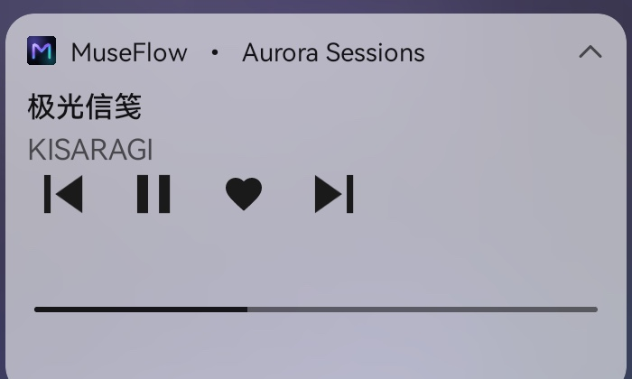
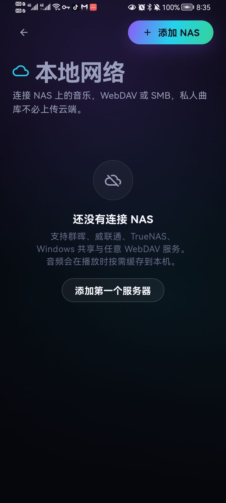

<p align="center">
  
</p>

<h1 align="center">MuseFlow · 沐声</h1>

<p align="center">
  多平台聚合音乐播放器 · 让声音自然流动
</p>

<p align="center">
  
  
  
  
</p>

---

MuseFlow 是一个完整的 Flutter 音乐播放器项目：从品牌 Logo、设计系统、动效，到聚合搜索、播放、歌词、队列、收藏、歌单、离线下载与设置，全部可运行。界面采用「Aurora Noir」视觉语言——近黑舞台、玻璃质感表面与极光渐变，适配手机、平板与桌面宽屏。


## 亮点

- **多平台聚合搜索**：网易云、酷我、酷狗、QQ 音乐、咪咕，一次搜索、统一结果。
- **自动换源**：当前音源无版权 / 需会员时，自动按标题、歌手、时长匹配其它平台的可播放版本。
- **完整播放体验**：队列、上一首 / 下一首、随机、列表循环、单曲循环、进度拖拽、音量、睡眠定时。
- **通知栏控制**：Android 通知栏 / iOS 锁屏媒体控制，支持播放、暂停、上一首、下一首、收藏与进度，后台持续播放。
- **逐行歌词**：LRC 解析、翻译合并、当前行高亮、点击歌词跳转，歌词自动滚动。
- **本地音乐库**：我喜欢的音乐、自建歌单、最近播放、离线下载，全部持久化到本机。
- **商业级界面**：响应式侧边栏 / 底栏、正在播放侧栏、迷你播放器、沉浸式全屏播放页、玻璃拟态、极光背景、等化器动效。
- **世界广播**：从 RadioHub 数据库精选 520 个实时电台，覆盖 190+ 国家；支持华语 / 欧美 / 日韩 / 世界、类型筛选、搜索、收藏与直播播放。
- **本地 NAS**：通过 WebDAV 或 SMB 接入群晖、威联通、TrueNAS、Windows 共享等私人音乐库；支持目录浏览、播放全部、收藏与按需缓存。
- **离线示例曲库**：内置 8 首由程序合成的原创氛围音乐（含封面与歌词），无网络也能完整体验。
- **品牌资产**：自绘 SVG Logo、应用图标、8 张专辑封面，已适配 Android / iOS / macOS / Web 图标。

| 搜索 | 播放器 | 音乐库 |
| --- | --- | --- |
|  |  |  |

> 截图使用 Web 预览构建，宽屏布局；移动端会自动切换为底部导航 + 迷你播放器。

<p align="center">
  
  
  
</p>

## 音乐资源如何获取

实现思路参考了 [guohuiyuan/go-music-dl](https://github.com/guohuiyuan/go-music-dl) 及其核心库 [music-lib](https://github.com/guohuiyuan/music-lib)，在 Flutter 侧重新实现了轻量客户端：

| 音源 | 搜索 | 播放直链 | 歌词 | 说明 |
| --- | --- | --- | --- | --- |
| 网易云音乐 | `music.163.com/api/search/get/web` | `api/song/enhance/player/url` + 外链兜底 | `api/song/lyric` | 默认音源，元数据最全 |
| 酷我音乐 | `search.kuwo.cn/r.s` | `antiserver.kuwo.cn/anti.s` | 需登录态，通常回退网易云 | 直链可用率高 |
| 酷狗音乐 | `songsearch.kugou.com/song_search_v2` | `m.kugou.com/app/i/getSongInfo.php` | `krcs.kugou.com` + `lyrics.kugou.com` | 部分曲目需会员 |
| QQ 音乐 | `c.y.qq.com/.../client_search_cp` | `u.y.qq.com` vkey 接口 | `fcg_query_lyric_new` | 会员曲目会自动换源 |
| 咪咕音乐 | `pd.musicapp.migu.cn/.../search_all.do` | 暂不支持 | 资源自带 LRC | 提供搜索与元数据 |
| MuseFlow 录音室 | 本地目录 | 本地资源 | 内置 LRC | 完全离线 |

播放失败时会按 `netease → kuwo → kugou → qq` 的顺序寻找同名、同歌手、时长接近的版本；成功后在播放器与迷你播放器中标注「已换源」。

> **版权声明**：本项目不存储、不托管任何音频文件，也不提供破解能力。所有音乐版权归各平台与版权方所有。接口仅用于个人学习、研究与技术交流，请勿用于商业用途，请支持正版音乐。

## 广播电台数据

`assets/data/radio_stations.json` 是从电台数据库 `radiohub.db` 精选出的轻量目录，打包进 App，避免把 58 MB 的原始 SQLite 数据库塞进安装包：

- 520 个可用电台（`lastcheckok = 1`），覆盖 190+ 个国家与地区
- 华语 / 欧美 / 日韩 / 世界分区，音乐、新闻、谈话、爵士、古典、电子等类型
- 字段包含流地址、图标、国家、语言、码率、HLS 标记与热度
- 由 `tool/gen_radio_catalog.py` 生成，原始数据来自 RadioHub / Radio Browser

重新生成：

```bash
python3 tool/gen_radio_catalog.py --db /path/to/radiohub.db
```

> 广播流由各电台公开提供，MuseFlow 不存储、不转码、不托管任何电台音频；版权归各电台所有。

## 本地 NAS

MuseFlow 可以把 NAS 当作私人音乐源，目录和音频不经过任何中转服务器：

- **WebDAV**：支持 HTTP / HTTPS、Basic Auth、自定义端口与路径，可关闭证书校验以连接自签名家庭 NAS。
- **SMB**：使用纯 Dart SMB 1 / 2 / 2.1 客户端，默认 445 端口，支持域 / 工作组。
- **使用方式**：音乐库 → 本地网络，或侧边栏 / 设置 → NAS 服务器。
- **能力**：浏览目录、播放全部、单曲播放、收藏、队列上一首/下一首。
- **缓存**：NAS 音频在首次播放时下载到应用临时目录，后续播放直接使用缓存，避免每次拖动都重新走网络。
- **安全**：服务器密码保存在 `flutter_secure_storage`（Android Keystore / iOS Keychain / macOS Keychain），不会写入歌曲模型或云端；配置文件里只有地址、端口、用户名等非敏感字段。

常见 NAS 配置：

| NAS | WebDAV 路径 | SMB 共享 |
| --- | --- | --- |
| 群晖 Synology | 控制面板 → 文件服务 → WebDAV，路径通常为 `/dav` | 共享文件夹名，如 `media` |
| 威联通 QNAP | 启用 WebDAV，路径以实际设置为准 | 共享文件夹名 |
| TrueNAS | 配置 WebDAV 共享 | 共享名 + 子目录 |
| Windows | 需另装 WebDAV 服务 | `\\主机\共享名` 对应共享名 |

> 限制：当前纯 Dart SMB 客户端最高支持 SMB 2.1，强制 SMB 3 的 NAS 可能无法连接；WebDAV 目前支持 Basic Auth，暂未实现 Digest Auth。Web 端无法创建本地缓存，NAS 播放请使用 Android / iOS / macOS 客户端。
>
> 测试说明：WebDAV 已用本地 WsgiDAV 服务 + Android 真机完成连接、目录浏览、缓存与播放验证；SMB 代码已接入并通过编译，但本次环境没有可用的 SMB NAS，建议在你的 NAS 上做一次端到端确认。

## 技术栈

- **Flutter 3.19 / Dart 3.3**，Material 3 自定义主题
- **just_audio + audio_session + audio_service**：跨平台音频播放、后台媒体会话与通知栏控制
- **smb_connect + WebDAV**：纯 Dart SMB 1/2/2.1 与 HTTP WebDAV 客户端
- **flutter_secure_storage**：NAS 密码存入系统安全存储
- **provider**：轻量状态管理（Player / Library / Settings / Download）
- **http**：各平台接口客户端，按音源隔离错误与超时
- **shared_preferences**：收藏、歌单、历史、设置持久化
- **cached_network_image**：封面缓存与渐变占位
- **path_provider**：离线下载目录
- **Inter / InterDisplay**：界面字体（本地打包，无网络字体依赖）
- **RadioHub 精选目录**：本地 JSON 电台快照，无需联网加载目录

## 目录结构

```
lib/
├── app.dart                 # Provider 装配、主题、本地化
├── main.dart                # 启动与本地数据加载
├── core/                    # 主题、工具、LRC 解析
├── models/                  # Song / Playlist / Download / RadioStation 模型
├── data/demo_catalog.dart   # 原创离线曲库与编辑精选
├── services/
│   ├── music_source.dart    # 音源抽象
│   ├── music_repository.dart# 聚合搜索、榜单、自动换源
│   ├── sources/             # 网易云 / 酷我 / 酷狗 / QQ / 咪咕 / 示例
│   ├── player_service.dart  # 队列、直播流与播放状态机
│   ├── radio_repository.dart# 广播目录加载、筛选与推荐
│   ├── nas_store.dart       # NAS 配置与安全凭据
│   ├── nas_service.dart     # NAS 浏览、下载缓存与播放解析
│   ├── nas/                 # WebDAV / SMB 客户端
│   ├── library_store.dart   # 收藏、歌单、历史、下载记录
│   ├── settings_store.dart  # 音质、音源开关、播放偏好
│   └── download_service.dart# 流式下载与本地持久化
└── ui/
    ├── screens/             # 发现、搜索、广播、音乐库、设置、播放器、歌单、榜单、NAS
    ├── sheets/              # 底部弹层
    └── widgets/             # 设计系统与业务组件
```

## 运行

环境：Flutter `>= 3.19`（Dart `>= 3.3.4`）。

```bash
flutter pub get
flutter run -d chrome        # Web 预览
flutter run -d macos         # macOS（需 Xcode）
flutter run -d android       # Android（需 Android SDK）
flutter run -d ios           # iOS（需 Xcode + 签名）
```

构建：

```bash
flutter build web --release --web-renderer html
flutter build apk --release --target-platform android-arm64
flutter build macos --release
flutter build ios --release --no-codesign
```

### 安装到 Android 手机

开启手机 USB 调试或无线调试，确认设备已连接：

```bash
adb devices
adb install -r build/app/outputs/flutter-apk/app-release.apk
```

项目提供的 arm64 安装包位于 `dist/MuseFlow-1.0.0-arm64.apk`（约 22 MB，包名 `app.museflow.museflow`，versionName `1.0.0`），使用本机自签名 keystore 完成签名（密钥与密码不纳入版本库），可直接安装；生产发布请替换为自己的正式签名。

### 电池与后台

Android 的媒体前台服务在**播放时**需要持有 `PARTIAL_WAKE_LOCK`，这是保证息屏后音频不断流的必要条件；真正的问题是暂停后没有释放。MuseFlow 已做以下处理：

- 暂停时立即退出前台服务并释放 WakeLock，不再阻止系统休眠
- 播放时持有 WakeLock，暂停/停止/播放结束后自动释放
- 15 分钟无播放自动关闭媒体服务与通知，避免留下常驻进程
- 不在 App 启动时激活 AudioSession，只在真正播放时由 just_audio 激活
- 通知栏收藏、NAS 缓存和广播播放都不额外持有 WakeLock

如果长时间**持续播放**（尤其是 24 小时广播或 NAS 串流），耗电和 WakeLock 属于正常现象；建议使用睡眠定时，或在长时间不听时暂停。部分华为/荣耀机型可在「设置 → 电池 → 应用启动管理」中允许 MuseFlow 后台运行，避免系统误杀播放服务。

### 平台说明

- **Android / iOS / macOS**：可访问全部第三方音源；首次构建请允许网络权限（项目已配置）。
- **Web**：浏览器受 CORS 限制，第三方接口可能拒绝跨域请求。Web 构建适合 UI 预览与离线示例曲库体验；完整曲库请使用 App / 桌面端。NAS 浏览还受目标 WebDAV 的 CORS 配置影响，且 Web 端不提供 NAS 缓存。
- **离线下载**：仅 App / 桌面端支持，文件保存在应用文档目录 `MuseFlow/Downloads`。
- **后台播放**：Android 使用 `audio_service` 前台媒体会话，通知栏与锁屏提供上一首 / 播放暂停 / 下一首 / 收藏；iOS 已声明 `audio` 后台模式并接入锁屏控制。

## 产品落地页

在线访问：https://richardliuxc.github.io/MuseFlow/

`landing/` 下是可直接部署的静态产品官网，包含 Hero 手机预览、功能 Bento、界面截图切换、音源介绍、APK 下载与响应式移动菜单。

```bash
cd landing
python3 -m http.server 8092
# 打开 http://localhost:8092/
```

落地页零外部依赖（字体、图片、APK 全部本地），可直接部署到 GitHub Pages / Cloudflare Pages。详细说明见 [`landing/README.md`](landing/README.md)。






## 测试

```bash
flutter analyze   # 0 issues
flutter test      # 17 tests
```

测试覆盖 LRC 解析与翻译合并、数据模型序列化、格式化工具，以及歌曲列表组件交互。

## 设计资产

- 品牌语：**Every sound, your flow.**
- 主色：`#8B5CF6` → `#22D3EE` → `#34D399` 极光渐变
- 背景：`#06070D` 近黑舞台
- Logo 由 `tool/gen_art.py` 生成 SVG 并通过无头 Chrome 栅格化；应用图标与专辑封面同源生成。
- 示例音乐由 `tool/gen_audio.py` 使用 numpy 合成，原创且可自由用于演示。

## 致谢

- [go-music-dl](https://github.com/guohuiyuan/go-music-dl) — 多平台音乐搜索与下载的接口与产品设计参考
- [music-lib](https://github.com/guohuiyuan/music-lib) — 各平台接口细节参考
- [Inter](https://rsms.me/inter/) — 字体
- Flutter 社区与所有音乐平台公开接口

## License

代码以 MIT License 发布。品牌名称、Logo、内置示例音乐仅用于本项目演示；第三方平台接口与内容版权归各自权利人所有。
